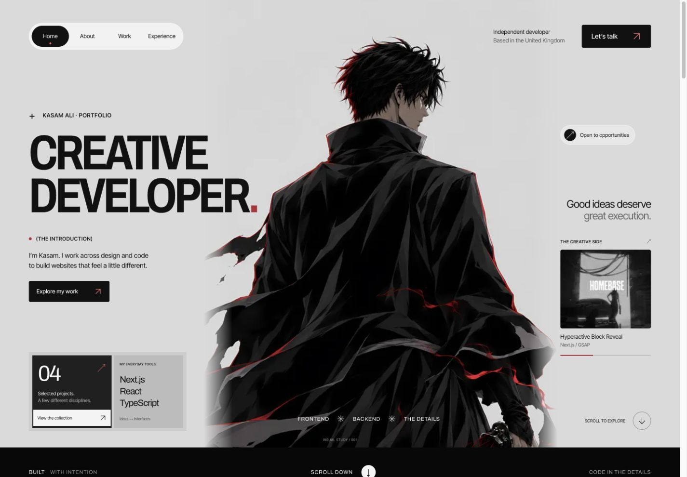

# Kasam Ali — Portfolio



Personal developer portfolio built with Next.js, React, TypeScript and CSS. The homepage includes selected projects, experience and a contact form. Project cards have hover effects and do not open previews.

## Development

Use Node.js 22.18 or newer.

```sh
npm ci
npm run dev
```

Open http://127.0.0.1:3000. Open this folder directly in VS Code; no special extensions or generated setup scripts are required.

```sh
npm test
npm run typecheck
npm run build
npm start
```

The servers bind to localhost. To use another port, append `-- --port 3001` to the dev or start command.

## Editing

| Change                                            | Location                                            |
| ------------------------------------------------- | --------------------------------------------------- |
| Projects, experience, skills and contact links    | `src/data/portfolio.ts`                             |
| Homepage section order                            | `src/app/page.tsx`                                  |
| Hero, about, work, experience, contact and footer layout  | `src/components/sections/`                          |
| Colours, spacing, typography and responsive rules | `src/styles/`                                       |
| Contact fields and feedback                       | `src/components/contact/`                           |
| Contact endpoint and public form identifier       | `src/lib/contact.ts`                                |
| Navigation, icons and clipboard control           | `src/components/ui/`                                |
| Page animations                                   | `src/components/motion/page-motion.tsx`             |
| Browser title, description and local fonts        | `src/app/layout.tsx`                                |
| Browser-tab icon                                  | `src/app/icon.svg`                                  |
| Artwork and screenshots                           | `public/images/hero/` and `public/images/projects/` |

The Bankai artwork is desktop-only and keeps the selected original file. The logo SVGs are in `public/brand/`; font licences are in `public/fonts/licenses/`. Tabb and Moonstone are private implementation work; their images show related public sites rather than private internal interfaces.

## Contact and security

The form reuses the existing Web3Forms public access key. Visitors submit their name, email and message directly to Web3Forms over HTTPS. The identifier is intentionally public; it is not a server credential. No environment file is required for local development. If the recipient/account changes, replace the public identifier in `src/lib/contact.ts` and verify delivery in that account.

See [architecture](docs/architecture.md), [security checks and remaining limits](docs/security.md) and [verification](docs/verification.md). No analytics, database, authentication or payment features are configured.
